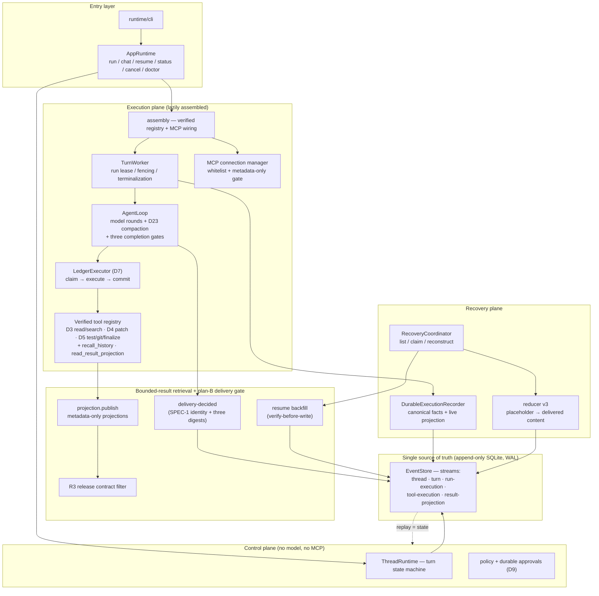

# KoawaAgent V2

An auditable, event-sourced local **coding-agent runtime** — built as a sequence
of executable slices, hardened through a five-round externally-reviewed security
program, and documented well enough to be reconstructed from its own event log.

> 中文简介见文末 [简体中文](#简体中文)。

---

## What this is

A local coding agent that **never trusts a model claim without a durable fact**.
Every state change is a typed event appended to a single SQLite event store
under an exact expected stream version; agent turns are replayed from that log,
not from memory. The model operates behind layered boundaries: a tool-execution
ledger, an output policy that keeps raw command bodies out of the model
service, per-profile release contracts, a durable delivery gate that serves the
model only **published, revocable projections** of test results, and an
isolated-workspace mode for synthetic test inputs.

It is a **security-engineering artifact**: the value is the evidence trail —
design docs, externally-reviewed verdicts, fault-injection tests, and a full
regression baseline — not a claim of being production-safe.

## Architecture (baseline `a051b65`)



Full annotated map (package-by-package, delivery lifecycle sequence, read-chain
channels, invariants): [docs/open-active/repo-map-and-architecture.md](docs/open-active/repo-map-and-architecture.md).

## Core guarantees (implemented, tested)

| Guarantee | Mechanism | Evidence |
|---|---|---|
| Every state change is auditable | typed events + exact expected stream version + idempotency keys; replay = state | `control/`, contract §7.5 verified checkpoints |
| Tools are claimed, executed once, and durably recorded | D7 ledger with recovery profiles; unknown outcomes stay `uncertain` | `ledger/`, D6/D7 suites |
| Model-visible test receipts are metadata-only by default | output gate (fixed structured diagnostics; bodies stay operator-side) | `verification/output_policy.py`, output-policy suite |
| Per-profile field release | `ReleaseRule` contracts (config → runner → receipt → delivery); sensitive-without-contract returns a fixed `result_withheld` + `human_required` state — never a failure | `tests/test_release_rules.py` |
| Model sees only **published** result projections | plan-B delivery gate: `result.delivery-decided.v1` (SPEC-1 identity without content, conflicting decisions rejected, restore replays the original decision); reducer v3 serves placeholder→delivered content identically on live and replayed paths | `tests/test_delivery_gate.py` (9 cases incl. W1–W3 crash windows), [spec v4](docs/open-active/hardening-memory-retrieval-2026-09-19/implementation/r2-delivery-gate-proposal.md) |
| Revocation / expiry / policy change honored on read | `result.projection-revoked/-expired.v1`; read chain refuses (`revoked`, `projection_expired`, `policy_superseded`); terminal catch-up never re-publishes | `tests/test_revocation.py` |
| Reads are bounded and honest | page-walked streams, 2000-event scan quota reported as `scan_truncated`, `ambiguous_reference` instead of guessing, cross-thread denied | `tests/test_result_read_tool.py` (7), [WP-E audit](docs/open-active/hardening-memory-retrieval-2026-09-19/implementation/wp-e-audit.md) |
| Final requests are capacity-checked independently | pre-send gate on final messages + the same pinned tool snapshot (tool name/description/schema + conservative protocol allowance + output reserve), unaffected by compaction toggles | `tests/test_request_metering_gate.py`, [measured band report](docs/open-active/hardening-memory-retrieval-2026-09-19/implementation/r4-measured-metering-report.md) |
| Synthetic test inputs run isolated | fixed-manifest ephemeral workspaces (read-only candidate copies + private scratch via `KOAWA_TEST_SCRATCH`); traversal/symlink guards; quarantine on cleanup failure; sensitive profiles refuse the host runner at config time | `tests/test_wp_c_workspace.py`, `tests/test_wp_c_manifest_guard.py` |
| Crashes recover without receipt backflow | `delivery_pending` state machine (paused / protocol-mismatch / corruption separated); recovery backfill never re-executes tools | `tests/test_delivery_gate.py`, D6/D23 recovery suites |
| MCP tools are whitelisted, metadata-gated | connection manager + activation governance (D10/D24/D25) | `mcp/`, D25 suites |
| Prompt-injection canary (scoped) | J2 exact-match gate with env-sourced key; ancestor-token scan implemented, child-agent coverage blocked by open B-3 wiring | [RT/J ledger](docs/open-active/rtj-progress.md) |

## Honest status (open items, on the record)

- `recall_history` still reads session history; wiring it to the projection
  stream (indexes, watermarks, resume cursors) is **recorded, not implemented**
  ([WP-E audit](docs/open-active/hardening-memory-retrieval-2026-09-19/implementation/wp-e-audit.md)).
- Summary references / protected groups (WP-F), fixed-artifact egress (WP-G),
  and the long-task parameter report (WP-H) are not implemented.
- WP-C remainder (Docker manifests, MCP adapter release rules, sensitive-
  container experiment matrix) and per-profile release-contract values are
  environment- / maintainer-input constrained.
- Read chain closure still requires current-**audience** checks and
  production-entry read verification.
- Delegation B-3 wiring (child-agent canary coverage) is open.
- Mimosa deep audit: commit/push scans returned inconclusive (`scanner_enobufs`);
  a full scan is pending. This repo does **not** claim to be vulnerability-free.

## Repository map

```text
v2/
├─ src/koawa_agent_v2/                                        # the runtime (116 modules)
│  ├─ control/      event-sourcing core: EventStore contract + SQLite
│  │                (typed events, exact-version CAS, idempotency keys;
│  │                 streams: thread/turn/run-execution/tool-execution/
│  │                 result-projection), ThreadRuntime state machine      ~6.7k
│  ├─ runtime/      AppRuntime (run/chat/resume/status/cancel/doctor),
│  │                assembly (control/execution planes), config, cli,
│  │                memory budgets (D23), session (D19), truth, gates     ~8.5k
│  ├─ execution/    AgentLoop: model rounds, D23 compaction, three
│  │                completion gates (D22 claim / D5 verify / R4 metered
│  │                final-send), plan-B delivery integration; TurnWorker  ~2.0k
│  ├─ model/        provider-neutral typed-stream protocol +
│  │                OpenAI-compatible chat client (any /chat/completions
│  │                endpoint: SiliconFlow, DeepSeek, Moonshot, vLLM…)     ~2.4k
│  ├─ ledger/       D7 tool-execution ledger: claim→execute→commit,
│  │                recovery profiles, J2 canary gate wiring              ~2.0k
│  ├─ verification/ D5 verification registry (test/git/finalize),
│  │                TrustedCommandRunner, output policy + per-profile
│  │                release contracts (§2/§4)                             ~1.9k
│  ├─ retrieval/    bounded-result retrieval: projection store
│  │                (publish/revoke/expire/delivery), contract-filtered
│  │                receipts, by-ref reads, thread-scoped search,
│  │                session recall                                        ~1.4k
│  ├─ recovery/     DurableExecutionRecorder (canonical facts + live
│  │                projection), reducer v3, verified checkpoint cache,
│  │                coordinator, delivery backfill                        ~3.6k
│  ├─ sandbox/      Docker runner + allocations; WP-C v1 isolated test
│  │                workspaces (manifest → read-only candidates + private
│  │                scratch)                                              ~2.8k
│  ├─ mcp/          D10/D24/D25 whitelist + metadata-only gate            ~5.9k
│  ├─ agents/       delegation graph (D12+; B-3 wiring open)             ~5.1k
│  ├─ tools/ editing/ workspace/ plan/ security/ context/ telemetry/
├─ tests/          134 modules — day-slice suites + hardening suites
│                  (delivery gate, revocation, release contracts, WP-C
│                  workspaces, N1 search, metering) + fixtures
├─ docs/           closed-archive (D1–D25 design history) ·
│                  open-active (living ledgers: closure review with five
│                  external rounds, self-audit, delivery-gate spec v4,
│                  WP-E audit, R4 metering report, experiment plan/matrix,
│                  repo map)
├─ scripts/        stability scenarios · R4 metering probe
└─ audits/         platform audit archives
```

Provider note: the model layer speaks OpenAI-compatible Chat Completions, so
any compatible endpoint works — SiliconFlow, DeepSeek official, Moonshot, or a
self-hosted vLLM. Switching provider = three config lines (`base_url`,
`api_key_env` name, `model`). Reasoning-effort knobs are whitelisted
fail-closed per provider family; unknown combos refuse rather than guess.

Day-slice design history (D1–D25) lives in
[docs/closed-archive/](docs/closed-archive/) — the day tables in previous
README versions pointed to pre-reorganization paths. Living documents
([docs index](docs/README.md)):

- [Closure review 2026-09-25](docs/open-active/implementation-closure-review-2026-09-25.md)
  — five external review rounds, verdicts archived.
- [R1–R5 self-audit table](docs/open-active/hardening-memory-retrieval-2026-09-19/implementation/r1r5-self-audit.md)
  — acceptance-clause-by-clause mapping with honest grades.
- [Delivery-gate spec v4](docs/open-active/hardening-memory-retrieval-2026-09-19/implementation/r2-delivery-gate-proposal.md)
  · [WP-E audit](docs/open-active/hardening-memory-retrieval-2026-09-19/implementation/wp-e-audit.md)
  · [R4 metering report](docs/open-active/hardening-memory-retrieval-2026-09-19/implementation/r4-measured-metering-report.md)
- [Threat model](docs/open-active/agent-security-threat-model.md) ·
  [PSEC ledger](docs/open-active/psec-progress.md) ·
  [RT/J ledger](docs/open-active/rtj-progress.md)

## Running and testing

Requirements: Python 3.13+ (standard library only; no third-party runtime
dependencies). Provider API keys are read from environment-variable **names**
in the config — never stored in the repo.

```powershell
# full regression (baseline: 1,137 tests · 0 failures · 0 errors · 32 skips)
$env:PYTHONPATH="src"; py -3.13 -B -m unittest discover -s tests -v

# run an agent task through the production CLI
py -3.13 -B -m koawa_agent_v2.runtime.cli run --config cfg.json --task "..."
py -3.13 -B -m koawa_agent_v2.runtime.cli resume --config cfg.json --turn-id <uuid>
```

A minimal `cfg.json` declares the repo, a state DB **outside** the repo, the
provider (base URL + `api_key_env` name + model), the sandbox runner, and
trusted test profiles (fixed argv, optional `release_fields` / `sensitive` /
`workspace_manifest`). See
[the MCP runbook](docs/open-active/d25-sandboxed-mcp-runbook.md) and
[config examples](docs/open-active/examples/). Docker is optional; sensitive
test profiles refuse the host runner by configuration instead of relaxing.

Workspace and collaboration rules: [AGENTS.md](AGENTS.md) — typed events only,
JSON persistence only, slice-scoped commits, evidence discipline (skipped
tests are not passes; audit conclusions are graded 实测确认 / 代码推断 / 待验证).

---

## 简体中文

KoawaAgent V2 是一个可审计、事件溯源的本地编码代理运行时。状态变更一律是
带精确流版本的 typed event，代理回合从事件日志重放而非内存恢复。模型侧有
分层边界：D7 工具账本、元数据-only 输出门、按 profile 的字段释放契约、
计划 B 交付门（模型只能读到**已发布且可撤销**的测试结果投影，原回执从不
进入模型上下文）、合成输入的隔离清单工作区。

- 架构：控制面/执行面双平面懒装配，SQLite 单一事实源（thread/turn/
  run-execution/tool-execution/result-projection 五类流），恢复走
  delivery_pending 状态机（paused/protocol/corruption 三态分离）。
- 验证基线：全量 1,137 项 / 0 失败 / 0 错误 / 32 跳过（Python 3.13）。
- 安全定位：这是安全工程产物——价值在设计文档、外部复验裁决、故障注入
  测试与证据链；**不是**"无漏洞"声明，开放边界全部在案（见上方 Honest
  status 与 [自审表](docs/open-active/hardening-memory-retrieval-2026-09-19/implementation/r1r5-self-audit.md)）。

协作与提交纪律见 [AGENTS.md](AGENTS.md)。
