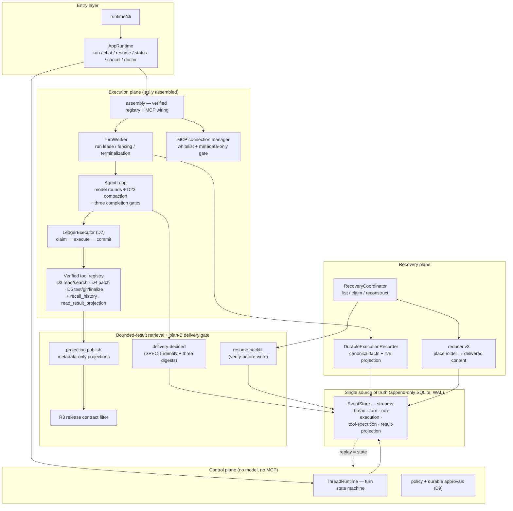

# KoawaAgent V2

An auditable, event-sourced local **coding-agent runtime** — built as a sequence
of executable slices, hardened through a five-round externally-reviewed security
program, and documented well enough to be reconstructed from its own event log.

> 中文简介见文末 [简体中文](#简体中文)。

---

## What this is

A local coding agent that **never trusts a model claim without a durable fact**.
Every state change is a typed event appended to a single SQLite event store
under an exact expected stream version; agent turns are replayed from that log,
not from memory. The model operates behind layered boundaries: a tool-execution
ledger, an output policy that keeps raw command bodies out of the model
service, per-profile release contracts, a durable delivery gate that serves the
model only **published, revocable projections** of test results, and an
isolated-workspace mode for synthetic test inputs.

It is a **security-engineering artifact**: the value is the evidence trail —
design docs, externally-reviewed verdicts, fault-injection tests, and a full
regression baseline — not a claim of being production-safe.

## Architecture (baseline `0902a98`)



### What each node in the diagram is and does

| Node | Module | What it does | On failure |
|---|---|---|---|
| **Entry layer** | | | |
| `runtime/cli` | `runtime/cli.py` | task runner + interactive session; `run / chat / resume / status / cancel / doctor` | stable config/path error codes; interactive stdin is read line-framed |
| `AppRuntime` | `runtime/app.py` | owns a turn end-to-end: run, resume, status, cancel, doctor; terminal catch-up for undelivered projections | recovery failures map to typed states (`turn_already_terminal`, `delivery_paused`) — never guessed |
| **Control plane** — no model, no MCP | | | |
| `ThreadRuntime` | `control/runtime.py` | turn state machine: threads and turns queued and advanced under exact-version CAS | stale commands rejected (`WrongExpectedVersion`) |
| `policy + approvals (D9)` | `policy.py`, `approval_service.py` | allow/deny/ask per action; per-principal action budgets; durable approvals | unlisted tools refuse `denied_by_default`; budget exhaustion fails the task closed |
| **Execution plane** — lazily assembled | | | |
| `assembly` | `runtime/assembly.py` | builds the execution plane: verified registry, policy wiring, MCP connections, retrieval tools, optional restricted shell | bad configs refuse at assembly (host runner without opt-in, unprotected test surface, shell mode without allowlist) |
| `TurnWorker` | `execution/worker.py` | run lease + fencing + terminalization for one turn execution | lost lease/orphan → stable error and the takeover path, never a retry storm |
| `AgentLoop` | `execution/loop.py` | model rounds: typed streaming, tool-call dispatch, D23 compaction, three completion gates (D22 claim / D5 verify / R4 metered final-send) | capacity exhaustion raises typed loop errors — no silent truncation |
| `LedgerExecutor (D7)` | `ledger/executor.py` | claim → execute → commit for every tool action; J2 canary gate inside the authorize path | crash mid-action leaves `uncertain`; never auto re-executed |
| `Verified tool registry` | `tools/` + `verification/` + `editing/` + `retrieval/` | the agent's hands: bounded reads/search, `apply_patch` (protected paths + control tree denied), test/git/finalize, projection read/search, opt-in restricted shell (structured argv + allowlist) | every tool error is a stable content-free code |
| `MCP connection manager` | `mcp/` | whitelisted servers, metadata-only result gate, per-server/tool release rules | untrusted results stay metadata-only; connection failures fail closed |
| **Delivery gate** | | | |
| `projection.publish` | `retrieval/projection.py` | publishes result projections: immutable body + CAS + idempotency; revoke/expire supported | identity conflict refuses; CAS conflict reads committed state |
| `R3 release contract filter` | `verification/release_contracts.py` | per-profile disclosure: `local_only / aggregate / limited / detailed`, field whitelists, producer rules | sensitive without contract → `result_withheld` + `human_required`, never a failure |
| `delivery-decided` | `execution/loop.py` + durable sink | the commit point that makes content model-visible: SPEC-1 identity + three digests | decision-write failure pauses the run (`delivery_pending`) |
| `resume backfill` | `recovery/delivery.py` via `runtime/app.py` | verify-before-write backfill of pending deliveries on restart | ambiguous/divergent → explicit corruption state; never silent |
| **Store** — append-only SQLite (WAL) | | | |
| `EventStore` | `control/event_store.py` + `control/sqlite_store.py` | typed events across five stream families (thread/turn/run-execution/tool-execution/result-projection); exact-version CAS; idempotency keys; global positions | wrong version/conflict raise typed errors; **replay = state** |
| **Recovery plane** | | | |
| `DurableExecutionRecorder` | `recovery/execution.py` | canonical tool-execution facts + live projection | unknown outcomes stay `uncertain` |
| `RecoveryCoordinator` | `recovery/` | lists stuck work, claims it, reconstructs | `recover_first`; never guesses |
| `reducer v3` | `recovery/context.py` + `recovery/protocol.py` | placeholder → delivered content identically on live and replayed paths | checkpoint mismatch → treated as a miss and recomputed |

Full annotated map (package-by-package, delivery lifecycle sequence, read-chain
channels, invariants): [docs/open-active/repo-map-and-architecture.md](docs/open-active/repo-map-and-architecture.md).

## Core guarantees (implemented, tested)

| Guarantee | Mechanism | Evidence |
|---|---|---|
| Every state change is auditable | typed events + exact expected stream version + idempotency keys; replay = state | `control/`, contract §7.5 verified checkpoints |
| Tools are claimed, executed once, and durably recorded | D7 ledger with recovery profiles; unknown outcomes stay `uncertain` | `ledger/`, D6/D7 suites |
| Model-visible test receipts are metadata-only by default | output gate (fixed structured diagnostics; bodies stay operator-side) | `verification/output_policy.py`, output-policy suite |
| Per-profile field release | `ReleaseRule` contracts (config → runner → receipt → delivery); sensitive-without-contract returns a fixed `result_withheld` + `human_required` state — never a failure | `tests/test_release_rules.py` |
| Model sees only **published** result projections | plan-B delivery gate: `result.delivery-decided.v1` (SPEC-1 identity without content, conflicting decisions rejected, restore replays the original decision); reducer v3 serves placeholder→delivered content identically on live and replayed paths | `tests/test_delivery_gate.py` (9 cases incl. W1–W3 crash windows), [spec v4](docs/open-active/hardening-memory-retrieval-2026-09-19/implementation/r2-delivery-gate-proposal.md) |
| Revocation / expiry / policy change honored on read | `result.projection-revoked/-expired.v1`; read chain refuses (`revoked`, `projection_expired`, `policy_superseded`); terminal catch-up never re-publishes | `tests/test_revocation.py` |
| Reads are bounded and honest | page-walked streams, 2000-event scan quota reported as `scan_truncated`, `ambiguous_reference` instead of guessing, cross-thread denied | `tests/test_result_read_tool.py` (7), [WP-E audit](docs/open-active/hardening-memory-retrieval-2026-09-19/implementation/wp-e-audit.md) |
| Final requests are capacity-checked independently | pre-send gate on final messages + the same pinned tool snapshot (tool name/description/schema + conservative protocol allowance + output reserve), unaffected by compaction toggles | `tests/test_request_metering_gate.py`, [measured band report](docs/open-active/hardening-memory-retrieval-2026-09-19/implementation/r4-measured-metering-report.md) |
| Synthetic test inputs run isolated | fixed-manifest ephemeral workspaces (read-only candidate copies + private scratch via `KOAWA_TEST_SCRATCH`); traversal/symlink guards; quarantine on cleanup failure; sensitive profiles refuse the host runner at config time | `tests/test_wp_c_workspace.py`, `tests/test_wp_c_manifest_guard.py` |
| Crashes recover without receipt backflow | `delivery_pending` state machine (paused / protocol-mismatch / corruption separated); recovery backfill never re-executes tools | `tests/test_delivery_gate.py`, D6/D23 recovery suites |
| MCP tools are whitelisted, metadata-gated | connection manager + activation governance (D10/D24/D25) | `mcp/`, D25 suites |
| Prompt-injection canary (scoped) | J2 exact-match gate with env-sourced key; ancestor-token scan implemented, child-agent coverage blocked by open B-3 wiring | [RT/J ledger](docs/open-active/rtj-progress.md) |
| Delegated identity cannot be forged | children may not adopt an ancestor's principal (`child_principal_impersonation`); roots are issued by the session record, not by a caller-chosen name; merge requests carry (source, run, digest) and pass terminal-class / run-binding / declared-scope gates before a parent may merge | `tests/test_delegation_identity.py`, `tests/test_session_root_issuance.py`, `tests/test_merge_source_gate.py` |

## Honest status (open items, on the record)

- `recall_history` still reads session history; wiring it to the projection
  stream (indexes, watermarks, resume cursors) is **recorded, not implemented**
  ([WP-E audit](docs/open-active/hardening-memory-retrieval-2026-09-19/implementation/wp-e-audit.md)).
- Summary references / protected groups (WP-F), fixed-artifact egress (WP-G),
  and the long-task parameter report (WP-H) are not implemented.
- WP-C remainder (Docker manifests, MCP adapter release rules, sensitive-
  container experiment matrix) and per-profile release-contract values are
  environment- / maintainer-input constrained.
- Read chain closure still requires current-**audience** checks and
  production-entry read verification.
- Delegation B-3 wiring (child-agent canary coverage) is open.
- Mimosa deep audit: commit/push scans returned inconclusive (`scanner_enobufs`);
  a full scan is pending. This repo does **not** claim to be vulnerability-free.

## Repository map

```text
v2/
├─ src/koawa_agent_v2/                                        # the runtime (128 modules)
│  ├─ control/      event-sourcing core: EventStore contract + SQLite
│  │                (typed events, exact-version CAS, idempotency keys;
│  │                 streams: thread/turn/run-execution/tool-execution/
│  │                 result-projection), ThreadRuntime state machine      ~6.7k
│  ├─ runtime/      AppRuntime (run/chat/resume/status/cancel/doctor),
│  │                assembly (control/execution planes), cli,
│  │                config split: config.py is a 35-line compat entry +
│  │                config_models / config_loading / config_credentials;
│  │                session split: session.py (history/journal) +
│  │                session_recall (lexical recall) + session_types;
│  │                memory budgets (D23), truth, gates                    ~8.7k
│  ├─ execution/    AgentLoop: model rounds, D23 compaction, three
│  │                completion gates (D22 claim / D5 verify / R4 metered
│  │                final-send), plan-B delivery integration; TurnWorker  ~2.0k
│  ├─ model/        provider-neutral typed-stream protocol +
│  │                OpenAI-compatible chat client (any /chat/completions
│  │                endpoint: SiliconFlow, DeepSeek, Moonshot, vLLM…)     ~2.4k
│  ├─ ledger/       D7 tool-execution ledger: claim→execute→commit,
│  │                recovery profiles, J2 canary gate wiring              ~2.0k
│  ├─ verification/ D5 verification registry (test/git/finalize),
│  │                TrustedCommandRunner, output policy + per-profile
│  │                release contracts, environment-signal classification,
│  │                dependency-preparation decisions                      ~2.7k
│  ├─ retrieval/    bounded-result retrieval: projection store
│  │                (publish/revoke/expire/delivery), contract-filtered
│  │                receipts, by-ref reads, thread-scoped search          ~1.8k
│  ├─ recovery/     DurableExecutionRecorder (canonical facts + live
│  │                projection), reducer v3, verified checkpoint cache,
│  │                coordinator, delivery backfill                        ~3.6k
│  ├─ sandbox/      Docker runner + allocations; WP-C v1 isolated test
│  │                workspaces (manifest → read-only candidates + private
│  │                scratch)                                              ~3.0k
│  ├─ mcp/          D10/D24/D25 whitelist + metadata-only gate +
│  │                per-server/tool release rules                         ~6.1k
│  ├─ agents/       delegation graph (D12+): control plane (session-issued
│  │                roots, impersonation guard, merge authorization gates),
│  │                message_service + shared event helpers; B-3 wiring
│  │                open                                                  ~5.6k
│  ├─ workspace/    effect-ledgered detached worktrees, content identity,
│  │                artifacts, patch-level merge boundary                 ~4.5k
│  ├─ tools/        repository tools + opt-in restricted shell
│  │                (structured argv, allowlist) + shell-review gate
│  ├─ editing/ plan/ security/ context/ telemetry/
├─ tests/          152 modules — day-slice suites + hardening suites
│                  (delivery gate, revocation, release contracts, WP-C
│                  workspaces, N1 search, metering, delegation identity,
│                  merge boundary, shell tool) + fixtures
├─ docs/           closed-archive (D1–D25 design history) ·
│                  open-active (living ledgers: closure review with five
│                  external rounds, self-audit, delivery-gate spec v4,
│                  WP-E audit, R4 metering report, agent-team baseline,
│                  session-root identity, logic-bypass audit, repo map)
├─ scripts/        stability scenarios · R4 metering probe · module-map
│                  generator · delegation probe
└─ audits/         platform audit archives
```

Provider note: the model layer speaks OpenAI-compatible Chat Completions, so
any compatible endpoint works — SiliconFlow, DeepSeek official, Moonshot, or a
self-hosted vLLM. Switching provider = three config lines (`base_url`,
`api_key_env` name, `model`). Reasoning-effort knobs are whitelisted
fail-closed per provider family; unknown combos refuse rather than guess.

Day-slice design history (D1–D25) lives in
[docs/closed-archive/](docs/closed-archive/) — the day tables in previous
README versions pointed to pre-reorganization paths. Living documents
([docs index](docs/README.md)):

- [Closure review 2026-09-25](docs/open-active/implementation-closure-review-2026-09-25.md)
  — five external review rounds, verdicts archived.
- [R1–R5 self-audit table](docs/open-active/hardening-memory-retrieval-2026-09-19/implementation/r1r5-self-audit.md)
  — acceptance-clause-by-clause mapping with honest grades.
- [Delivery-gate spec v4](docs/open-active/hardening-memory-retrieval-2026-09-19/implementation/r2-delivery-gate-proposal.md)
  · [WP-E audit](docs/open-active/hardening-memory-retrieval-2026-09-19/implementation/wp-e-audit.md)
  · [R4 metering report](docs/open-active/hardening-memory-retrieval-2026-09-19/implementation/r4-measured-metering-report.md)
- [Threat model](docs/open-active/agent-security-threat-model.md) ·
  [PSEC ledger](docs/open-active/psec-progress.md) ·
  [RT/J ledger](docs/open-active/rtj-progress.md)

## Running and testing

Requirements: Python 3.13+ (standard library only; no third-party runtime
dependencies). Provider API keys are read from environment-variable **names**
in the config — never stored in the repo.

```powershell
# full regression (baseline: 1,287 tests · 0 failures · 0 errors · 35 skips)
$env:PYTHONPATH="src"; py -3.13 -B -m unittest discover -s tests -v

# run an agent task through the production CLI
py -3.13 -B -m koawa_agent_v2.runtime.cli run --config cfg.json --task "..."
py -3.13 -B -m koawa_agent_v2.runtime.cli resume --config cfg.json --turn-id <uuid>
```

A minimal `cfg.json` declares the repo, a state DB **outside** the repo, the
provider (base URL + `api_key_env` name + model), the sandbox runner, and
trusted test profiles (fixed argv, optional `release_fields` / `sensitive` /
`workspace_manifest`). See
[the MCP runbook](docs/open-active/d25-sandboxed-mcp-runbook.md) and
[config examples](docs/open-active/examples/). Docker is optional; sensitive
test profiles refuse the host runner by configuration instead of relaxing.

Workspace and collaboration rules: [AGENTS.md](AGENTS.md) — typed events only,
JSON persistence only, slice-scoped commits, evidence discipline (skipped
tests are not passes; audit conclusions are graded 实测确认 / 代码推断 / 待验证).

---

## 简体中文

KoawaAgent V2 是一个可审计、事件溯源的本地编码代理运行时。状态变更一律是
带精确流版本的 typed event，代理回合从事件日志重放而非内存恢复。模型侧有
分层边界：D7 工具账本、元数据-only 输出门、按 profile 的字段释放契约、
计划 B 交付门（模型只能读到**已发布且可撤销**的测试结果投影，原回执从不
进入模型上下文）、合成输入的隔离清单工作区。

- 架构：控制面/执行面双平面懒装配，SQLite 单一事实源（thread/turn/
  run-execution/tool-execution/result-projection 五类流），恢复走
  delivery_pending 状态机（paused/protocol/corruption 三态分离）。
- 架构图逐节点说明（它是什么、在哪个模块、做什么、失败时的表现）见上方
  英文节 "What each node in the diagram is and does" 表；要点中文速记：

  | 节点 | 做什么 | 失败时 |
  | --- | --- | --- |
  | AppRuntime | 一个 turn 的全程：run/resume/status/cancel + 终态补发投影 | 恢复失败映射为类型化状态，不猜 |
  | ThreadRuntime | turn 状态机，精确版本 CAS 推进 | 过期命令直接拒（WrongExpectedVersion） |
  | policy + approvals (D9) | 每个动作的 allow/deny/ask + 动作预算 | 未列入的工具 `denied_by_default` |
  | assembly | 懒装配执行面：注册表/策略/MCP/检索/可选 shell | 配置不完整在装配期拒绝 |
  | TurnWorker | run 租约 + 围栏 + 终态化 | 租约丢失走接管，不重试风暴 |
  | AgentLoop | 模型回合 + D23 压缩 + 三道完成门 | 容量耗尽抛类型化错误，不静默截断 |
  | LedgerExecutor (D7) | 每个工具动作 claim→execute→commit，J2 canary 在授权路径 | 崩溃即 `uncertain`，绝不自动重跑 |
  | 工具注册表 | 有界读搜/补丁/测试/git/finalize/投影读/可选受限 shell | 工具错误全是稳定内容无关码 |
  | MCP 管理器 | 白名单 + 元数据-only 门 + 逐 server 释放规则 | 不可信结果只给元数据 |
  | projection.publish | 发布结果投影（不可变正文 + CAS + 可撤销） | 身份冲突拒绝，CAS 冲突读已提交态 |
  | 释放契约过滤 | 四档披露 + 字段白名单 + 生产者规则 | 敏感无契约 → `result_withheld` + 人工 |
  | delivery-decided | 模型可见性的提交点（SPEC-1 身份 + 三个摘要） | 决定写入失败 → `delivery_pending` |
  | resume backfill | 重启时先验证后补发 | 歧义/分叉 → 显式 corruption 态 |
  | EventStore | 五类流 append-only typed event | **重放即状态** |
  | Recorder / Coordinator / reducer v3 | 事实账 / 认领重建 / 占位→正文一致 | unknown 保持 unknown；缓存对不上按未命中 |

- 验证基线：全量 1,287 项 / 0 失败 / 0 错误 / 35 跳过（Python 3.13）。
- 安全定位：这是安全工程产物——价值在设计文档、外部复验裁决、故障注入
  测试与证据链；**不是**"无漏洞"声明，开放边界全部在案（见上方 Honest
  status 与 [自审表](docs/open-active/hardening-memory-retrieval-2026-09-19/implementation/r1r5-self-audit.md)）。

协作与提交纪律见 [AGENTS.md](AGENTS.md)。
