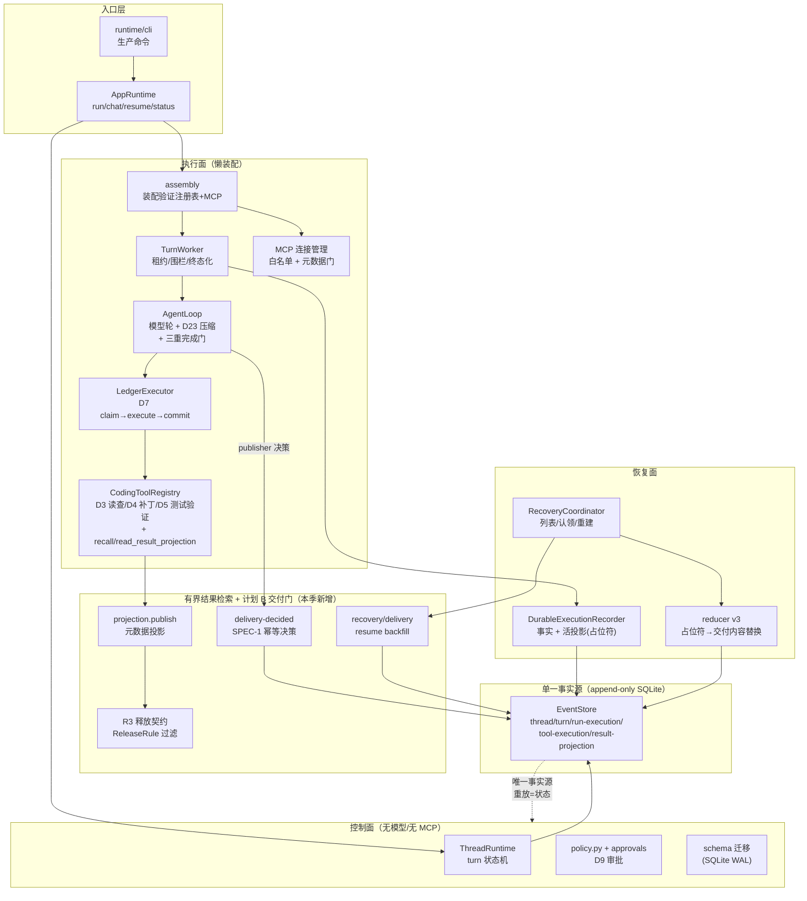
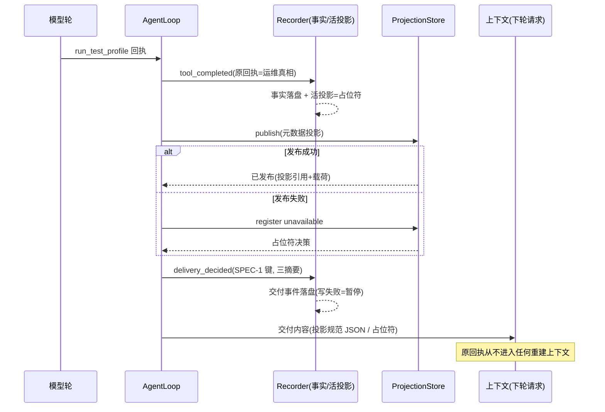
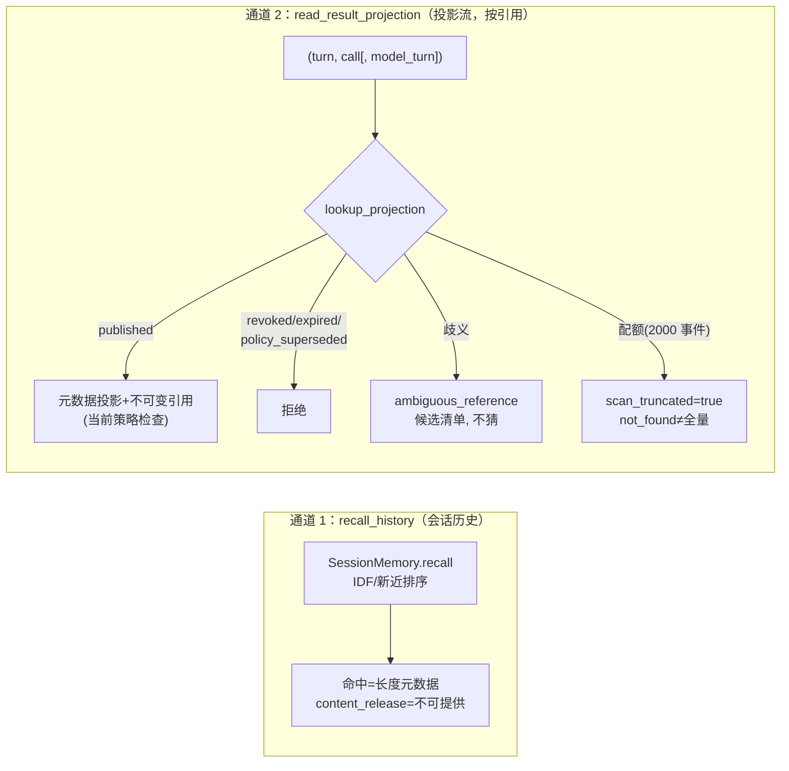

# KoawaAgent V2 仓库地图与架构图

基线：`a051b65`（2026-10-03）。两图均为现状快照；计划 B 交付门与 WP-C
隔离工作区为本季新增层。配套：`hardening-memory-retrieval-2026-09-19/`。

## 一、仓库地图（v2/，116 源文件 / 133 测试文件）

```text
v2/
├─ src/koawa_agent_v2/
│  ├─ control/          # 事件溯源内核：EventStore 契约 + SQLite 实现
│  │                    #   (typed events, 精确版本 CAS, 幂等键, 流:
│  │                    #    thread/turn/run-execution/tool-execution/
│  │                    #    result-projection), ThreadRuntime 状态机,
│  │                    #    schema 迁移, read_snapshot     ~6.7k 行
│  ├─ runtime/          # 应用层：AppRuntime(run/chat/resume/status/
│  │                    #   cancel/doctor), assembly(控制面/执行面装配),
│  │                    #   config, cli, memory(D23 预算), session(D19),
│  │                    #   turn_conclusion/turn_summary, claim_gate,
│  │                    #   truth, subprocess_env, mcp_sandbox_labels ~8.5k
│  ├─ execution/        # AgentLoop：模型轮循环、D23 压缩、三重门
│  │                    #   (D22 claim gate / D5 completion gate /
│  │                    #    R4 独立最终请求门), 计划 B 交付集成
│  │                    #   TurnWorker：run 租约/围栏/终态化        ~2.0k
│  ├─ model/            # Provider 流协议：typed stream(Header/Item/
│  │                    #   Turn), 请求构造, 流装配器                ~2.4k
│  ├─ ledger/           # D7 工具执行账本：claim→execute→commit,
│  │                    #   恢复档案, J2 security gate 接线, 策略引擎 ~2.0k
│  ├─ verification/     # D5 验证：验证注册表(run_test_profile/git/
│  │                    #   finalize), TrustedCommandRunner, output_policy
│  │                    #   (安全诊断 + R3 释放契约), finalization    ~1.9k
│  ├─ retrieval/        # 有界结果检索（本季新增面）：projection(发布/
│  │                    #   撤销/过期/交付决策/lookup + 配额),
│  │                    #   recall_tool(会话历史元数据检索),
│  │                    #   result_read_tool(按引用读取)             ~1.4k
│  ├─ recovery/         # D6 恢复：DurableExecutionRecorder(run-execution
│  │                    #   事实 + 活投影), 压缩协议, checkpoint 验证缓存,
│  │                    #   RecoveryCoordinator, delivery backfill    ~3.6k
│  ├─ sandbox/          # D8/D25 容器执行：DockerCommandRunner, 分配/租约,
│  │                    #   WP-C v1 隔离测试工作区(test_workspace)    ~2.8k
│  ├─ tools/            # 工具地基：registry, schema, workspace 解析,
│  │                    #   repo_map                                  ~2.9k
│  ├─ editing/          # D4 补丁协议：apply_patch 事务/故障注入      ~1.4k
│  ├─ mcp/              # D10/D24/D25 MCP：connection_manager(白名单+
│  │                    #   元数据-only 门), activation, 适配器       ~5.9k
│  ├─ agents/           # D12+ 委派图（子代理，B-3 接线在案）        ~5.1k
│  ├─ security/         # J2 金丝雀检测（semantics-C）               ~0.3k
│  ├─ workspace/        # 工作区快照/基线证据                        ~3.6k
│  ├─ context/ plan/ telemetry/  # 上下文片段 / 计划板 / 故障注入点
├─ tests/               # 133 个测试模块：day 切片套件 + 加固套件
│  │                    #   (test_delivery_gate/test_revocation/
│  │                    #    test_release_rules/test_wp_c_*/
│  │                    #    test_result_read_tool/...) + fixtures/
├─ docs/                # closed-archive(D1-D25 历史) / open-active(活文档)
│  │                    #   hardening-memory-retrieval-2026-09-19/ = 本季
│  │                    #   设计/规格/进度/定档唯一审阅面
├─ scripts/             # 稳定场景 / r4 计量探针
└─ audits/              # 平台审计档案（09-07 / 09-11）
```

## 二、架构总图（双平面 + 单一事实源）



## 三、计划 B 交付生命周期（测试回执的模型可见性）



## 四、读取链双通道现状



## 五、关键不变量速查

- 状态变更 = typed event + 精确 expected version；幂等键决定重放语义。
- 敏感原文（stdout/stderr/环境）不进模型服务：output gate（安全诊断）
  → R3 释放契约 → 计划 B 交付（投影派生）三道闸。
- 恢复 = 重放事实 + 交付决策；backfill 先验后写（协议版本/源事实/围栏）；
  paused / protocol_mismatch / corruption 三态分离。
- 测试基线：全量 ~1137 项 / 0 失败 / 32 跳过（Docker/provider）。
